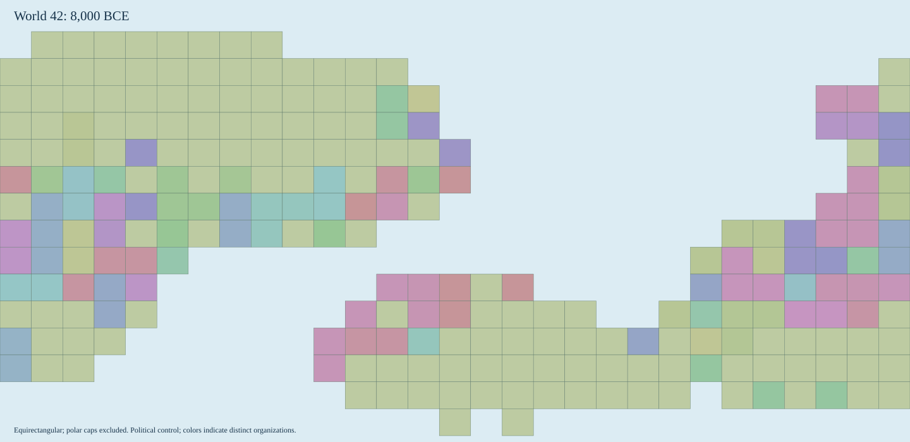

# World History Simulator

A deterministic procedural-history simulator with an interactive browser atlas. Generate a fictional world, advance its history, inspect maps at earlier dates, branch a checkpoint and compare scenarios.

Built with Python and NumPy, a packageable command-line interface, and a browser interface using standard HTML, CSS and JavaScript. The engine tracks population cohorts, food, trade, migration, political control, languages and technology through annual transitions. Every committed year retains accounting receipts and exact state patches for replay.


*Current application in Chromium: a generated world with 240 provinces, advanced through ten simulated years. Generation, map display, province inspection, and layer switching were checked in the browser.*



*An actual exported fictional-world map: seed 42, 240 provinces, year offset 1,000 (8,000 BCE), from the earlier `earthlike-0.6` model. Colors distinguish simulated political organizations. This illustrates the export format; current code uses the revised food-limited `earthlike-0.7` model. The [SVG](docs/preview/atlas.svg), [manifest](docs/preview/manifest.json) and [export metadata](docs/preview/export-metadata.json) preserve provenance.*

## What it demonstrates

- Seeded geography and keyed random streams, preserving reproducibility without coupling unrelated draws.
- Conservation checks for population transfers, food shipments, resources and treasury flows.
- Atomic annual commits, historical replay, interrupted-run resume and stale-writer protection.
- Checkpoint branching with recorded interventions, date-aligned comparisons and historical entity dossiers.
- A local atlas with map layers, search, a timeline and exports to SVG, GeoJSON, CSV and a cited event overview.

## Run locally

Requires Python 3.11+ and NumPy 2.x. From this checkout:

```sh
python -m venv .venv
.venv/bin/python -m pip install -e .
./launch-atlas.sh
```

Open **http://127.0.0.1:8765** and select **Generate world**. The server binds to loopback. Saves live in the ignored `runs/` directory. Stop with Ctrl+C; committed years remain saved. Use `./launch-atlas.sh --port 8766` for another port.

For a small command-line example, choose a new unused directory:

```sh
.venv/bin/python -m worldsim generate --seed 73 --provinces 64 --run-dir runs/example
.venv/bin/python -m worldsim simulate --manifest runs/example/manifest.json --years 100
.venv/bin/python -m worldsim validate --manifest runs/example/manifest.json --deep
.venv/bin/python -m worldsim export --manifest runs/example/manifest.json --year 100 --output exports/example
```

Existing saves and exports are protected against overwriting. Every command supports `--help`. Preserve the NumPy, engine, parameter and schema versions recorded in a save's manifest for replay; saves do not migrate automatically. Large or long-running worlds produce substantial event ledgers.

## Architecture and checks

`worldsim/geography.py` creates the world; `systems.py` and `engine.py` implement annual transitions; `storage.py` owns saved histories; `application.py` coordinates operations; `server.py` and `worldsim/web/` provide the atlas. See [model contracts](docs/MODEL.md), [population mechanics](docs/POPULATION.md) and the [design specification](docs/specification.md).

```sh
.venv/bin/python -m unittest discover -s tests -v
node --check worldsim/web/atlas.js
bash -n launch-atlas.sh
```

The offline suite contains 41 tests covering deterministic generation, conservation, replay, resume, branches, exports, real HTTP-handler routing, asynchronous run/pause and subsistence regressions. A browser-check script is available at `tools/test_atlas.py`; it requires an existing Playwright/Chromium installation and should target a separately started server with a temporary empty runs directory. [Verification](docs/VERIFICATION.md) records checks actually run on this publication snapshot.

## Limits and rights

This is an exploratory model of fictional histories. Historical calibration, held-out empirical validation and expert review remain outstanding. Geographic cells, climate, economies, institutions and languages are deliberately coarse. Population is an exact engine count; many map layers are model estimates. Branch differences describe simulated scenarios and do not establish identified causal effects. No imported HYDE, Seshat, UN, PHOIBLE or Glottolog datasets are bundled.

The repository contains source, tests and a small synthetic preview; it excludes private machine state, development archives and multi-gigabyte histories. No software license grant has been supplied. Copyright remains with the respective owners; public visibility alone does not grant permission to reuse the code.
