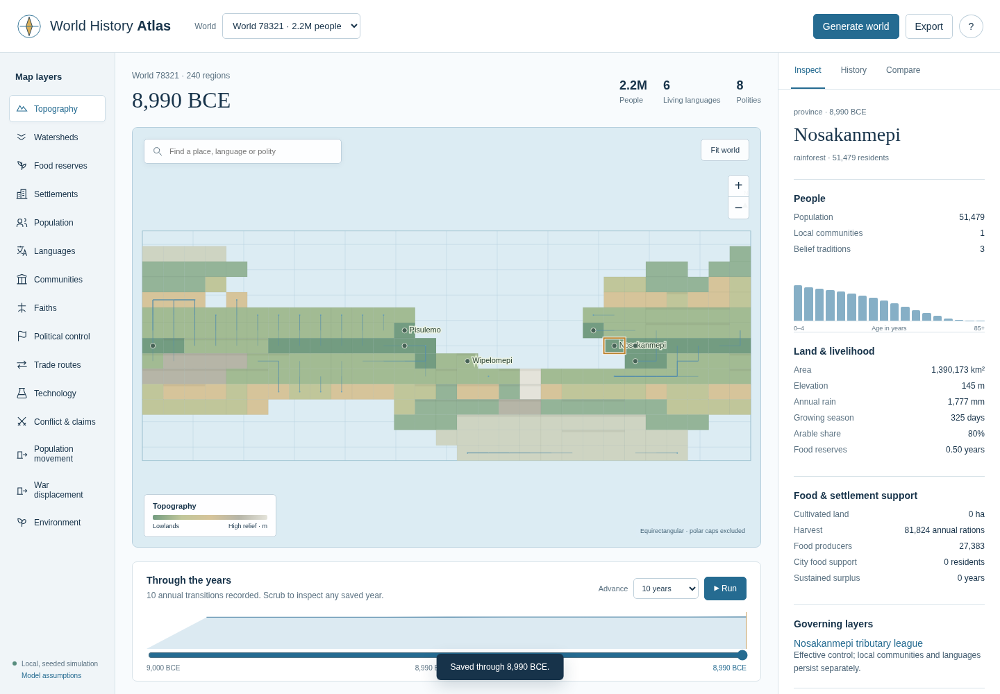

# Publication verification — 2026-10-03

Checks run on the isolated source snapshot:

| Command | Result |
| --- | --- |
| `PYTHONDONTWRITEBYTECODE=1 python -m unittest discover -s tests -v` | 41 tests passed, 19.793 seconds, exit 0 |
| `node --check worldsim/web/atlas.js` | Passed, exit 0 |
| `bash -n launch-atlas.sh` | Passed, exit 0 |
| `uv build --offline` | Source distribution and wheel built, exit 0 |

Wheel ZIP inspection confirmed `worldsim/web/index.html`, `atlas.js` and `atlas.css` are included. Application source and tests are copied without changes from the local original. The publication manifest excludes the original DOCX specification and includes the portable Markdown docs and small preview.

Tests use temporary simulation stores and exercise real HTTP handlers without listening sockets. They verify internal model/software consistency. These checks do not establish historical realism, expert calibration, full-scale performance targets or causal identification.

## Live browser smoke test

A separate Playwright smoke test passed against the publication copy using installed Chromium **151.0.7922.173**, a loopback server and an initially empty temporary save directory. The test used `uv run --offline --no-project --with playwright`; no original saves were read or modified.

Verified the initially empty atlas, generation through the browser controls with seed **78321** and **240 provinces**, a painted map canvas, advancement by **10 years** to **8,990 BCE**, opening a province dossier and switching political/topography layers. The run used engine **0.1.0**, parameter version **earthlike-0.7** and NumPy **2.5.2**. The browser reported **zero page errors, failed requests or HTTP error responses**. The server was stopped by the lifecycle helper after the test.

The screenshot was visually inspected and contains only generated fictional-world data. This smoke test does not cover browser branching, comparison, export downloads, mobile layout, accessibility or other browsers. The broader `tools/test_atlas.py` flow remains available for those additional checks.

The original SVG/PNG preview is actual saved synthetic output from model `earthlike-0.6`; current source and the live-browser screenshot use `earthlike-0.7`. The original preview's manifest and export metadata are supplied alongside it. No saved simulation database is bundled.
